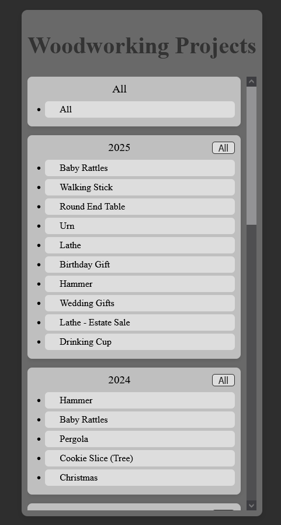
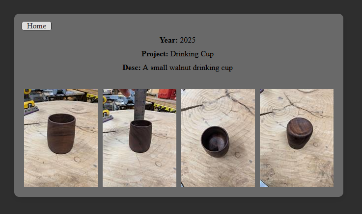
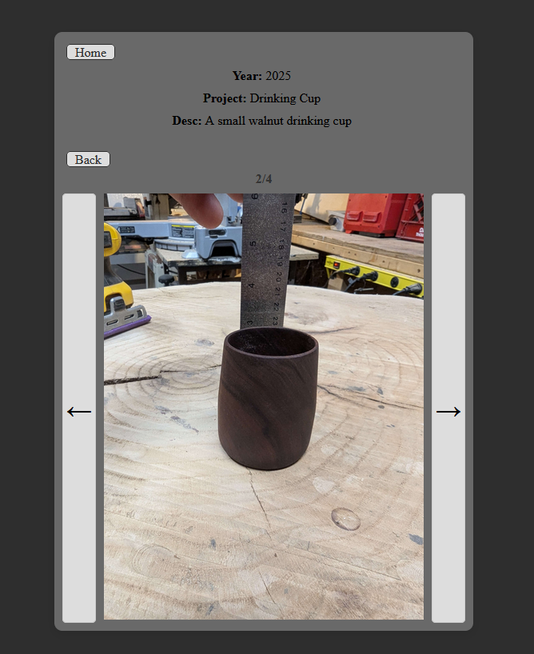
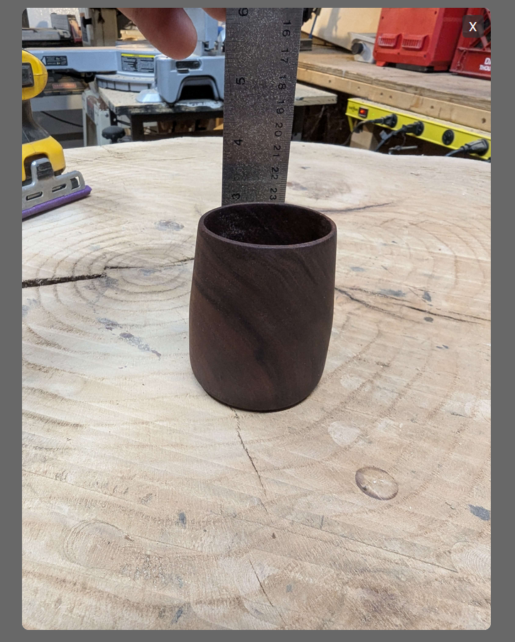

# WoodworkingProjects

> This project is to showcase the woodworking projects <br/>
> [Live - WoodWorking Projects Website](https://woodworking-projects.ryan-brock.com/)

Screenshots:





---

## 📚 Table of Contents

- [What's My Purpose?](#-whats-my-purpose)
- [How to Use](#-how-to-use)
- [Technologies](#-technologies)
- [VS Code Workspace](#-vs-code-workspace)
- [Getting Started (Local Setup)](#-getting-started-local-setup)
  - [Run Locally](#run-locally)
  - [Test](#test)
  - [GitHub Hooks](#github-hooks)
  - [Build](#build)
  - [Deploy](#deploy)
- [How to Contribute](#-how-to-contribute)

---

## 🧠 What's My Purpose?

This is an angular frontend, prerendered to static pages at build time (one per year and project), created to showcase the woodworking projects. Project data comes from `public/project-list.json`, generated by the [image repo](https://github.com/rbrock44/woodworking-projects-images/).

---

## 🚦 How to Use

- `Select Project` - Select any project (from any year or select `All` for an entire year)
- `Select Image` - Selecting an image from the project level will expand and make the images larger (but single view)
- `Expanded Image` - Click an image in single image project view and the image will be expanded to full screen with buttons (on the side(s) of the image to go forward and backward)
- `Previous / Next` - Links at the bottom of a project, or of a photo in no project opened on its own, step through everything in home page order: newest year first, each year's projects and the photos listed between them, one photo at a time. Each link shows whether it leads to a project or a single photo
- `Search` - Filter projects by name, year or description on the home page, or photos within a project
- `Favorites` - Two kinds, both kept in this browser: a whole project (the heart on its home page row, or `Favorite this project` beside its name on its own page), or a single photo, in a project or not (the heart on its tile in any grid or on the home page, or beside `Back` while it's open). The `Favorites` group and its `All` show them apart, projects under one heading and photos under another; a favorited photo opens where it lives, in its project at that photo. `Share` makes a link carrying both kinds
- `Where it's from` - In views that mix projects (a year's `All`, `Favorites`) each photo tile names its project; a photo in no project shows nothing extra
- `Jump` - Press `Ctrl K` (or the `Jump` button) to jump straight to any project, or to any photo that belongs to no project

---

## 🛠 Technologies

- Framework: `Angular 22` (static prerendering via `@angular/ssr`)
- Testing: `Vitest`
- Deployment: `GitHub Pages`

---

## 🖥️ VS Code Workspace

A `woodworking.code-workspace` file is included in this repo. It opens both this project and the [woodworking-projects-images](https://github.com/rbrock44/woodworking-projects-images/) repo in a single VS Code instance.

**For the workspace file to work correctly, both repos must live side by side in the same parent folder:**

```
parent-folder/
├── woodworking-projects/        ← this repo
└── woodworking-projects-images/ ← image repo
```

Open the workspace by selecting **File > Open Workspace from File...** and choosing `woodworking.code-workspace`.

---

## 🚀 Getting Started (Local Setup)

* Install [node](https://nodejs.org/en) - v24 (see `.nvmrc`)
* Clone [repo](https://github.com/rbrock44/woodworking-projects)
* Clone [image repo](https://github.com/rbrock44/woodworking-projects-images/) into the same parent folder (required for the VS Code workspace)

---

### Run Locally

```
npm install
npm start
```

---

### Test

- Unit
    - `ng test` || `npm run test`

---

### Github Hooks

- Build
    - Trigger: On Push to `master`
    - Action(s): Runs tests, builds application then kicks off gh page action to deploy build output

---

### Build

Run `npm run deploy` to build the project, prerender every page and write `sitemap.xml` and `404.html`. The build artifacts will be stored in the `dist/woodworking-projects/` directory.

---

### Deploy

Push to `master` and the GitHub Action builds and deploys to GitHub Pages. There is no local deploy command

---

## 🤝 How to Contribute

Found a typo or a small, obvious fix? Open a PR directly.
Want to change behavior or add something bigger? Open an issue first so we can talk it through before you put in the work.

---
